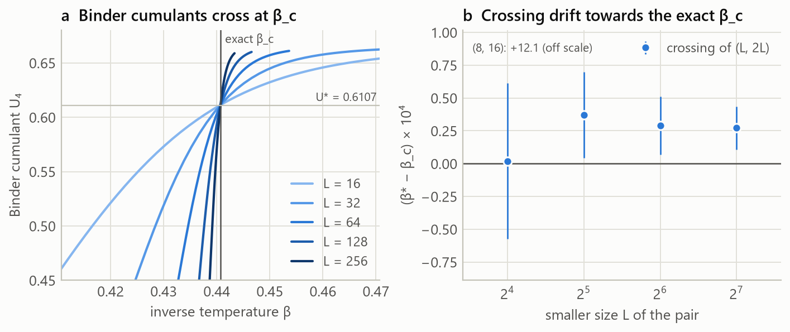
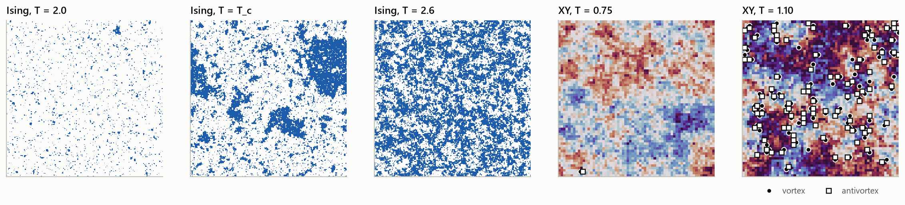
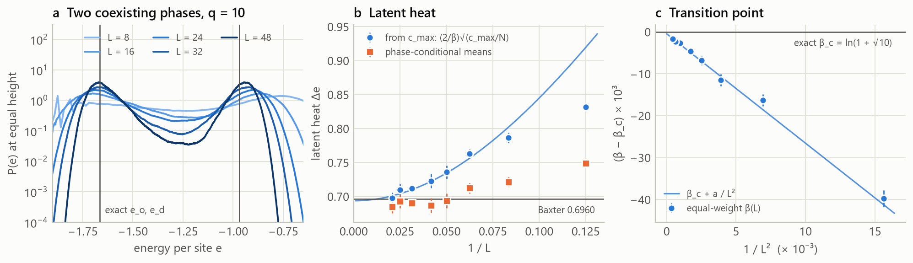

# critmc

**Monte Carlo simulation, exact solutions and statistical analysis of critical phenomena in lattice spin models.**

`critmc` is a research-grade Python framework for studying phase transitions
with Markov-chain Monte Carlo. It combines numba-compiled samplers for the
Ising, Potts, XY/Heisenberg and Edwards–Anderson spin-glass models with an
exact-solution layer that checks them, a rigorous error-analysis toolkit and
finite-size-scaling machinery. Eleven reproducible studies range from a
pull-distribution validation against Kaufman's exact solution to a
disorder-averaged 3D spin-glass campaign.

<p align="center">
  
</p>

## Highlights

| system | quantity | critmc | exact / best literature |
|---|---|---|---|
| 2D Ising, 16×16 | 160 pulls vs Kaufman's exact solution | mean +0.12, sd 0.93 | 𝒩(0, 1) |
| 2D Ising (exact) | 1/ν from Fisher zeros up to L = 512 | 1.00013 (local, L = 384–512) | 1 |
| 2D Ising, L ≤ 256 | 1/ν · γ/ν · β/ν | 0.9991(18) · 1.75047(39) · 0.12480(24) | 1 · 7/4 · 1/8 |
| 2D Ising | β_c from Binder crossings | 0.440714(16) | 0.4406868 |
| 2D Ising dynamics | z, Metropolis / Wolff | 2.12(3) / 0.16–0.28 | 2.1667(5) / ≈ 0.25 |
| q = 10 Potts | latent heat (multicanonical) | 0.6937(51) | 0.696049 (Baxter) |
| XY | T_BKT (Weber–Minnhagen) | 0.8917(5) | 0.89294(8) |
| 3D Ising, L ≤ 48 | β_c · 1/ν · γ/ν | 0.2216505(39) · 1.591(13) · 1.957(5) | 0.221654626 · 1.5874 · 1.9637 |
| 3D EA spin glass | T_c · ν (joint scaling fit) | 0.938(54) · 2.19(20) | 0.951(9) · 2.44(9) |

Every number comes from `results/*.json` and is reproduced by
`python experiments/run_all.py`. The full write-up, including the estimators
that *fail* and why, is in [`docs/report.md`](docs/report.md).

<p align="center">
  
</p>
<p align="center">
  
</p>

## What is inside

| layer | modules | contents |
|---|---|---|
| geometry | `lattice` | chain, square, triangular, cubic, hypercubic tori; neighbour tables in forward/backward pair form |
| models & kernels | `models`, `kernels/*` | Ising (with field), q-state Potts, O(n) vector models, Edwards–Anderson; Metropolis, heat bath (incl. von Mises and Heisenberg), over-relaxation, Wolff and Swendsen–Wang (incl. O(n) embedding) |
| Markov-chain drivers | `sim`, `flathist`, `glass`, `runner` | canonical chains with update schedules and auto-tuning; Wang–Landau with the 1/t refinement; multicanonical sampling; parallel tempering with round-trip and feedback diagnostics; parallel, resumable batch execution |
| exact results | `exact/*` | Onsager; Kaufman's finite-torus partition function with analytic derivatives; **exact integer density of states by complex-temperature evaluation + arbitrary-precision FFT**; Fisher zeros; Potts self-duality and Baxter's latent heat; O(n) rings by transfer operators; brute-force enumeration |
| statistics | `stats/*` | FFT autocorrelation, Madras–Sokal windowing, **Wolff's Γ-method** for derived quantities, Flyvbjerg–Petersen blocking with Jonsson's automatic plateau test, jackknife (incl. independent data sets), i.i.d./block/stationary bootstrap with BCa intervals |
| reweighting | `reweight` | single-histogram reweighting, **MBAR/multi-histogram** solved by Newton's method on the convex objective, effective sample sizes |
| finite-size scaling | `fss` | multi-histogram data per size, jackknife through the full reweighting pipeline, Binder crossings, peak finding, weighted fits with corrections to scaling, Houdayer–Hartmann data collapse |

Every sampler is tested statistically against an exact result: brute-force
enumeration, Kaufman's formula, the exact density of states, or the
transfer-operator solution of O(n) rings. The suite has 180 tests.

## Installation

```bash
git clone https://github.com/lance-lii/critmc.git
```
```bash
cd critmc
```
```bash
python -m venv .venv
```
```bash
.venv/Scripts/python -m pip install -e ".[dev]"
```

On macOS/Linux use `.venv/bin/python`. Requires Python ≥ 3.10, numpy, scipy,
numba, mpmath and matplotlib (`gmpy2` speeds up the arbitrary-precision exact
solutions).

## Quick start

```python
from critmc import Ising, Simulation, square
from critmc.exact import kaufman, onsager
from critmc.stats import gamma_method

L, beta = 32, onsager.BETA_C
sim = Simulation(Ising(square(L)), beta, updates="wolff", seed=42)
sim.thermalize(2_000)
ts = sim.run(50_000)

e = gamma_method(ts["e"])                      # error bar with autocorrelations
print(e.value, e.error, "exact:", kaufman.energy(beta, L))
```

Update schedules compose freely, e.g. `"heatbath+4*overrelax+wolff"` for the
Heisenberg model. A `wolff` term without a count is tuned to about one sweep
per measurement. More examples are in [`examples/`](examples).

### Command line

```bash
critmc simulate --model xy --L 32 --T 0.9 --updates "metropolis+2*overrelax+wolff"
```
```bash
critmc exact zeros 16 32 64 128 256
```
```bash
critmc exact dos --L 32 --out dos32.txt
```
```bash
critmc bench
```

## Reproducing the results

```bash
python experiments/run_all.py --quick
```
```bash
python experiments/run_all.py
```

The quick run takes minutes; the full campaign takes a few hours on 8 cores.
Raw time series go to `$CRITMC_DATA` (default `data/`) and are reused when a
run is interrupted. On Windows, if the project sits under a very long path,
point `CRITMC_DATA` and `NUMBA_CACHE_DIR` to short directories, because
compiled-kernel caches and data files can otherwise exceed the 260-character
path limit. Numerical results are written to `results/*.json`,
figures to `docs/figures/`, and all tables are regenerated from the JSON files
into [`docs/results_tables.md`](docs/results_tables.md).

| experiment | question |
|---|---|
| E01 validation | Do all four algorithms reproduce the exact 16×16 thermodynamics, and are the error bars honest? |
| E02 exact | Exact g(E) up to L = 64, Fisher zeros up to L = 512, specific-heat amplitude |
| E03 2D Ising FSS | β_c, ν, γ/ν, β/ν, U* from simulations only, compared with the exact solution |
| E04 dynamics | Dynamic critical exponents of local vs cluster algorithms |
| E05 Wang–Landau | Error saturation of Wang–Landau vs t^(−1/2) convergence of the 1/t refinement |
| E06 q = 10 Potts | Latent heat, transition point and interface tension of a first-order transition |
| E07 XY | Berezinskii–Kosterlitz–Thouless temperature from the helicity-modulus jump |
| E08 3D Ising | Critical coupling and exponents without an exact solution |
| E09 spin glass | 3D Edwards–Anderson transition from correlation-length crossings |
| E10 benchmarks | Kernel throughput |
| E11 snapshots | What the Ising and BKT transitions look like (configurations and vortices; figure only) |

## Documentation

* [`docs/theory.md`](docs/theory.md) — the mathematics: models, balance
  conditions of every algorithm, exact solutions and the complex-temperature
  density-of-states method, Fisher zeros, flat-histogram methods, parallel
  tempering, error analysis, reweighting and finite-size scaling.
* [`docs/report.md`](docs/report.md) — the scientific report: methods,
  results, systematic effects and discussion for all eleven studies.
* [`docs/results_tables.md`](docs/results_tables.md) — generated tables.

## Repository layout

```
src/critmc/          library (kernels, models, drivers, exact, stats, analysis)
tests/               pytest suite (statistical tests against exact results)
experiments/         the studies (E01–E11), run_all.py and the table generator
examples/            short scripts showing the API
docs/                theory, report, figures, generated tables
results/             numerical results of the studies (JSON)
```

## Testing

```bash
python -m pytest
```

The suite runs in about a minute. Statistical tests are seeded, so they are
deterministic. Their tolerance (|z| < 4.5 with batch-means errors) means a
correct sampler essentially never fails, while a bias of a few standard errors
is caught.

## License

MIT — see [LICENSE](LICENSE).
