# Critical phenomena by Monte Carlo simulation: methods, validation and results

*Technical report of the `critmc` project. Mathematical details are in
[`theory.md`](theory.md); every number below is generated from
`results/*.json` (see [`results_tables.md`](results_tables.md)).*

## Summary

`critmc` combines numba-compiled Markov-chain samplers (Metropolis, heat
bath, over-relaxation, Wolff and Swendsen–Wang cluster updates, Wang–Landau,
multicanonical sampling, parallel tempering) with exact finite-size solutions
and an error-propagating analysis pipeline (Γ-method, blocking, jackknife
through multi-histogram reweighting, bootstrap over disorder). Eleven studies
use it:

| study | result | reference |
|---|---|---|
| validation, 2D Ising 16×16 | 160 pulls against Kaufman's exact solution: mean +0.12, sd 0.93 | 𝒩(0, 1) |
| exact g(E), Fisher zeros | exact integer g(E) up to L = 64 (g_max ≈ 10¹²³¹); 1/ν from zeros → 1.00013 at L = 512 | 1 |
| 2D Ising FSS, L ≤ 256 | 1/ν = 0.9991(18), γ/ν = 1.75047(39), β/ν = 0.12480(24), β_c = 0.440714(16) | 1, 7/4, 1/8, 0.4406868 |
| dynamics | z_Metropolis = 2.12(3), z_heat-bath = 2.18(5), z_SW, z_Wolff ≈ 0.2–0.3 | 2.1667(5), ≈ 0.25 |
| Wang–Landau | 1/t refinement: error ∝ t^−0.55, 10× below the saturated original | t^−1/2 |
| q = 10 Potts | latent heat 0.6937(51), β_c = 1.42561(33) | 0.696049, 1.4260624 (exact) |
| XY model | T_BKT = 0.8917(5) (Weber–Minnhagen) | 0.89294(8) |
| 3D Ising | β_c = 0.2216505(39), 1/ν = 1.591(13), γ/ν = 1.957(5) | 0.221654626(5), 1.58737, 1.96370 |
| 3D EA spin glass | T_c = 0.938(54), ν = 2.19(20) | 0.951(9), 2.44(9) |

Wherever an exact result exists the agreement is within statistical errors
(typically ≤ 1.5σ). Where the agreement fails, the report shows why:
logarithmic corrections, corrections to scaling, mixed-phase contamination,
or too few disorder samples.

---

## 1. Introduction

Near a continuous phase transition, fluctuations are correlated over
distances much larger than the lattice spacing. Thermodynamic quantities then
follow power laws with universal exponents that do not depend on microscopic
details. Monte Carlo simulation is the standard numerical tool for such
systems. It is also a good test of statistical rigour, for three reasons:

1. **Samples are correlated.** Markov-chain samples are autocorrelated, and near
   $T_c$ the autocorrelation time of local algorithms diverges (*critical
   slowing down*). Naive error bars are then too small by large factors.
2. **Estimators are non-linear.** Crossing points, peak heights and data-collapse
   parameters are complicated functions of the data. Their errors must be
   propagated through the whole analysis, not attached to its inputs.
3. **Finite-size effects are systematic.** Simulations run on finite lattices,
   and the thermodynamic limit is reached only through finite-size scaling.
   Its corrections must be modelled or bounded.


*Equilibrium configurations generated by `critmc` (E11). 256×256 Ising
model below, at and above $T_c$: at $T_c$ clusters of all sizes coexist.
64×64 XY model below and above $T_\text{BKT}$, colour = spin angle, with
vortices (●) and antivortices (□) marked: below the transition a single bound
pair, above it a plasma of 95 vortices and 95 antivortices. The counts are
always equal because the net vorticity on a torus vanishes.*

This project builds the full pipeline, from compiled Markov-chain kernels to
error-propagating finite-size-scaling fits, and validates it wherever an
exact answer exists. For the 2D Ising model the finite-lattice solution
(Kaufman 1949) gives exact references for every temperature and size. It is
used to show that the samplers are unbiased *and* that the error bars are
honest. The same machinery is then applied to four systems without exact
finite-size solutions: the XY model, the 3D Ising model, the 10-state Potts
model and the 3D Edwards–Anderson spin glass.

## 2. Software architecture

```mermaid
flowchart LR
    subgraph compiled["numba kernels"]
        KI[ising / potts / on]
        KF[flathist]
        KG[glass]
    end
    LAT[lattice] --> MOD[models]
    MOD --> SIM[sim.Simulation]
    KI --> SIM
    KF --> FH[flathist: Wang–Landau, multicanonical]
    KG --> PT[glass: parallel tempering]
    SIM --> RUN[runner: parallel, resumable batches]
    RUN --> RW[reweight: single histogram, MBAR]
    FH --> RW
    RW --> FSS[fss: crossings, peaks, fits, collapse]
    ST[stats: Γ-method, blocking, jackknife, bootstrap] --> FSS
    EX[exact: Onsager, Kaufman, exact g(E), Fisher zeros, enumeration, rings] -. validates .-> SIM
    EX -. validates .-> FSS
```

Design decisions that matter for correctness and performance:

* **One compiled call per chain segment.** Each model has a single `run`
  kernel that executes an *update schedule* (for example Metropolis followed
  by three over-relaxation sweeps and Wolff clusters) many times and records
  the measurements. Python overhead is therefore negligible even on a 3×3
  lattice. Integer energies and magnetisations are tracked incrementally and
  exactly; continuous-spin energies are recomputed at every measurement.
* **Reproducible random streams.** Every chain draws from a NumPy `Generator`
  (PCG64-DXSM) that numba consumes directly, so Python and compiled code
  share one state. Batch jobs derive their streams from `SeedSequence` spawn
  keys such as `(experiment, L, run)`. Any single run of a large batch can
  therefore be reproduced in isolation, independently of scheduling.
* **Lattice-agnostic kernels.** Kernels see only a neighbour table and a bond
  list. Adding a lattice never touches compiled code, and the same kernels
  run on chains, square, triangular and cubic tori.
* **Error propagation through the full analysis.** Estimators are functions of
  a combined (multi-histogram) ensemble. The jackknife removes a block from
  every run of a lattice size, re-solves the reweighting equations and repeats
  the entire estimate.
* **Restartability.** Batches write each finished chain to disk and skip
  existing files, so a campaign lasting hours survives interruption. The
  worker count adapts to the memory available for new processes (on Windows
  the commit limit, not physical RAM, is what kills workers).

## 3. Methods in brief

| task | method | where |
|---|---|---|
| sampling | Metropolis, heat bath, over-relaxation, Wolff, Swendsen–Wang (with O(n) embedding) | `kernels/` |
| first-order transitions | Wang–Landau (1/t) → multicanonical production run | `flathist` |
| rugged landscapes | parallel tempering, two replica sets, log-binned equilibration test | `glass` |
| error bars | Γ-method (derived quantities), blocking, jackknife through the analysis, bootstrap over disorder | `stats`, `fss` |
| interpolation in β | single-histogram and MBAR multi-histogram reweighting | `reweight` |
| infinite-volume limit | Binder crossings, fixed-β_c fits, peak scaling, data collapse, corrections to scaling | `fss` |
| exact references | Onsager, Kaufman (analytic derivatives), exact g(E) by complex-temperature FFT, Fisher zeros, Baxter, transfer operators, enumeration | `exact/` |

All studies use the root seed `20260924`. A study is reproduced with
`python experiments/eNN_*.py`; `--quick` runs it with reduced statistics.

## 4. Validation against the exact finite-lattice solution (E01)

**Question.** Do all four samplers produce the exact canonical averages, and
do the Γ-method error bars have the right size?

**Setup.** 16×16 Ising torus, 20 temperatures from 1.6 to 3.4 (including
$T_c$). Metropolis and heat bath: $10^5$ sweeps per temperature;
Swendsen–Wang and Wolff: $4\times10^4$ sweep-equivalents. For each run the
energy per site and the specific heat (a non-linear function of two means)
are compared with Kaufman's exact values, giving 40 pulls
$z = (\text{MC} - \text{exact})/\sigma$ per algorithm.

**Result.** If the estimates are unbiased and the errors correct, the pulls
are standard normal:

| algorithm | mean pull | sd of pulls | χ² / dof | KS p-value |
|---|---|---|---|---|
| Metropolis | +0.34 | 0.83 | 31.2 / 40 | 0.03 |
| Heat bath | +0.06 | 0.99 | 38.0 / 40 | 0.17 |
| Swendsen–Wang | +0.11 | 0.96 | 36.7 / 40 | 0.65 |
| Wolff | −0.02 | 0.94 | 34.5 / 40 | 0.58 |
| **pooled** | +0.12 | 0.93 | — / 160 | 0.09 |

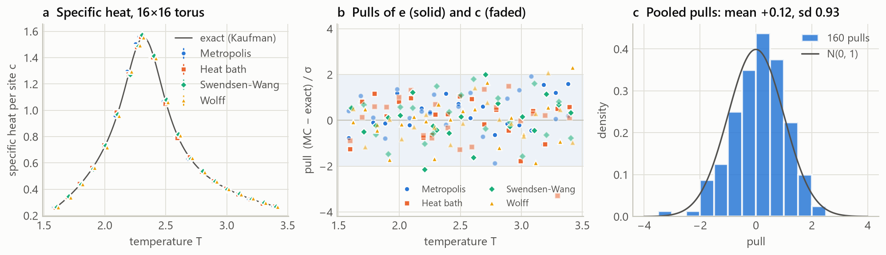

The pooled distribution of 160 pulls is consistent with $\mathcal N(0,1)$
(Kolmogorov–Smirnov $p = 0.09$), and every algorithm has $\chi^2/\text{dof}$
between 0.78 and 0.95. There is no sign of bias, and the Γ-method errors are
accurate, including those of the specific heat at $T_c$ where
autocorrelations are strongest. Metropolis has the largest mean pull (+0.34)
and the smallest KS p-value (0.03). With four algorithms tested, a p-value
this small arises by chance about one time in nine. Its pulls are also
narrower than normal (sd 0.83), so its error bars are, if anything, slightly
*conservative*. This is expected: for slowly decaying autocorrelations the
automatic window errs towards larger $\tau_\text{int}$.

## 5. Exact results (E02)

**Exact densities of states.** The complex-temperature method of
[theory §3.3](theory.md#33-exact-density-of-states-by-complex-temperature-evaluation)
produced the integer $g(E)$ for $L = 4, 8, 16, 32, 64$. Every result passed the
sum rule $\sum_E g(E) = 2^{L^2}$, the symmetry $g_j = g_{N-j}$ and the
low-energy degeneracies. For $L = 64$ there are 4095 occupied levels and the
largest degeneracy is $\approx 10^{1231}$; the computation took 3.6
minutes on one core (≈1300 significant digits, 8192-point FFT). The entropy densities
$\ln g/N$ converge to Onsager's $s(e)$ (panel a).

**Fisher zeros.** The complete zero maps for $L = 8$ and 12 lie close to
Fisher's circles $|u\pm1| = \sqrt2$ (panel b), already at these tiny sizes.
The leading zero was followed to $L = 512$ by Newton iteration on the
analytically continued partition function. Its distance to $u_c = \sqrt2-1$
scales as $L^{-1/\nu}$, and the local exponent from consecutive sizes
decreases monotonically,

| L | 16 | 32 | 64 | 128 | 256 | 512 |
|---|---|---|---|---|---|---|
| local 1/ν | 1.01121 | 1.00377 | 1.00144 | 1.00061 | 1.00028 | 1.00013 |

converging to $1/\nu = 1$ with corrections $\approx 0.07/L$ (panel c). This
is a determination of $\nu$ *without any simulation*.

**Specific-heat amplitude.** The exact maxima $c_\text{max}(L)$ for
$L = 16\ldots2048$, fitted with the Ferdinand–Fisher form
$A\ln L + B + (C\ln L + D)/L$, give $A = 0.494518$ against the exact
$8K_c^2/\pi = 0.494539$. A naive two-parameter fit $A\ln L + B$ to the same
maxima gives 0.4981, 0.7 % too high:
logarithmic corrections are easy to underestimate, which matters for the
Monte Carlo analysis in the next section.

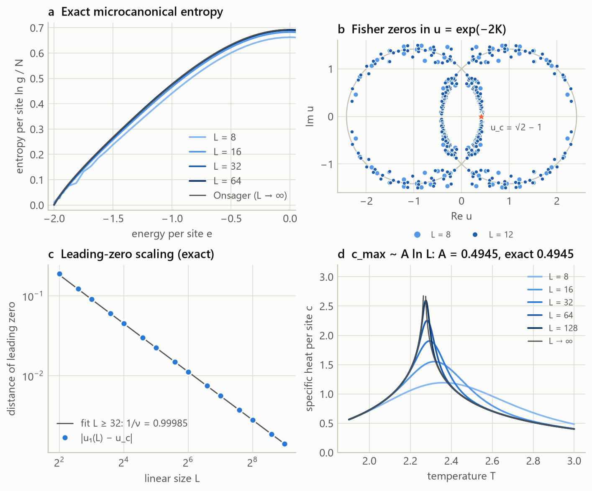

## 6. Finite-size scaling of the 2D Ising model (E03)

**Question.** Starting from simulations alone, how precisely can the critical
point and exponents be determined, and do the error bars hold up against the
exact answers?

**Setup.** $L = 8, 16, 32, 64, 128, 256$. For each size, three Wolff runs at
$\beta_c$ and $\beta_c\pm1/\sigma_E(L)$ (one standard deviation of the energy)
with $5\times10^5$ (L ≤ 32) down to $1.25\times10^5$ (L = 256) sweep-equivalent
measurements. The three runs of a size are combined by MBAR. Every estimate
carries a 32-block jackknife error that re-solves the MBAR equations for each
replicate, and every search in β is confined to the window where the
reweighted ensemble keeps at least 5 % of its effective sample size.

**Observables at the exact $\beta_c$.** The Monte Carlo specific heat, a
fluctuation quantity sensitive to any bias, agrees with Kaufman's exact value
within 1.3σ at five of the six sizes. At $L = 32$ it lies 2.8σ low; one such
deviation among six sizes occurs by chance about 3 % of the time, and the
specific-heat maximum from the same runs is only 1.2σ low.

| L | U₄ | dU/dβ | χ | ⟨\|m\|⟩ | c (MC) | c (exact) | dev. |
|---|---|---|---|---|---|---|---|
| 8 | 0.612958(93) | 1.3858(31) | 18.2340(78) | 0.77706(21) | 1.1467(14) | 1.14556 | +0.8σ |
| 16 | 0.611320(98) | 2.8016(63) | 61.508(33) | 0.71324(23) | 1.5010(17) | 1.49870 | +1.3σ |
| 32 | 0.61131(13) | 5.542(15) | 207.50(14) | 0.65515(26) | 1.8407(22) | 1.84677 | −2.8σ |
| 64 | 0.61111(13) | 11.152(35) | 698.11(41) | 0.60078(22) | 2.1937(30) | 2.19221 | +0.5σ |
| 128 | 0.61079(21) | 22.36(12) | 2343.5(24) | 0.55027(35) | 2.5353(78) | 2.53633 | −0.1σ |
| 256 | 0.61018(29) | 44.89(29) | 7861(11) | 0.50376(44) | 2.889(10) | 2.87979 | +0.8σ |

**Critical point.** The Binder cumulants of successive sizes cross at
$\beta^*(L, 2L)$, which drifts towards $\beta_c$ as $L^{-1/\nu-\omega}$
($\omega = 2$ for the 2D Ising model). The crossings for $L\ge16$ are already
within $4\times10^{-5}$ of the exact value, and the largest pair gives
$\beta^*(128, 256) = 0.440714(16)$, 1.7σ from the exact 0.4406868. A fit with
the expected $L^{-3}$ drift gives 0.440716(13), 2.4σ above: the three
largest pairs all lie about $3\times10^{-5}$ high, and at these sizes the
drift is too small for the fit to separate that common offset from the
limit. With the exact answer known, this is a mild tension, not a
demonstrated bias; the data collapse below shows the same tendency.


**Exponents.** Fits $y = aL^{x}$ for $L\ge16$ at the exact $\beta_c$ (panel
titles give the exact values):

| quantity | estimator | Monte Carlo | exact | deviation | χ²/dof |
|---|---|---|---|---|---|
| 1/ν | dU/dβ | 0.9991(18) | 1 | −0.5σ | 10.6/3 |
| 1/ν | d ln⟨m²⟩/dβ, with background | 1.0018(20) | 1 | +0.9σ | 10.4/3 |
| γ/ν | χ = βN⟨m²⟩ | 1.75047(39) | 1.75 | +1.2σ | 24.0/3 |
| γ/ν | χ, with background | 1.74933(52) | 1.75 | −1.3σ | 14.5/3 |
| β/ν | ⟨\|m\|⟩ | 0.12480(24) | 0.125 | −0.9σ | 21.6/3 |
| A | c_max = A ln L + B + D/L | 0.4980(47) | 0.49454 | +0.7σ | — |

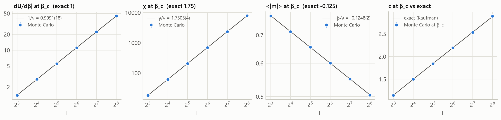

All exponents agree with the exact values to within 1.3σ at a relative
precision of $2\times10^{-4}$–$2\times10^{-3}$. The χ²/dof values of 3–8 are
informative rather than alarming. With errors of $4\times10^{-4}$ on γ/ν, the
data resolve the sub-leading terms of the scaling forms. The plain
$\partial_\beta\ln\langle m^2\rangle$ fit, for example, gives $1/\nu = 1.036$,
and only the analytic background term brings it to 1.002. Two further
estimators illustrate the same point:

* the height and position of the connected-susceptibility peak give
  γ/ν = 1.7590(10) and 1/ν = 0.955(5). The peak sits away from $\beta_c$,
  where corrections to scaling are larger, so these estimators are biased by
  much more than their statistical errors at the sizes used;
* the specific-heat maxima reproduce the exact finite-size maxima at every
  $L$ (pulls 0.4, 0.9, −1.2, 1.9, −0.2, 0.2). With the Ferdinand–Fisher
  correction they give the log-amplitude $A = 0.4980(47)$; a plain $A\ln L+B$
  fit would be biased, exactly as E02 showed with exact data.

**Data collapse.** Collapsing $U_4(\beta, L)$ for $L = 32\ldots256$ against
$(\beta-\beta_c)L^{1/\nu}$ with free $\beta_c$ and $1/\nu$, then collapsing
$\chi L^{-\gamma/\nu}$ at that $\beta_c$:

| collapse | β_c | 1/ν | γ/ν | quality S |
|---|---|---|---|---|
| U₄ (β_c, 1/ν free) | 0.4407149(68) | 0.9981(18) | — | 0.48 |
| χ L^{−γ/ν} (at that β_c) | — | 0.9863(15) | 1.7506(4) | 1.09 |

Both collapses are good by their own measure ($S = 0.48$ and 1.09; panel a).
The Binder collapse gives 1/ν within 1.1σ of 1, and the χ collapse gives γ/ν
within 1.7σ of 7/4. The χ collapse's own $1/\nu = 0.9863(15)$, however, is
9σ low. It draws on χ away from $\beta_c$, where corrections to scaling are
large, and is biased in the same direction as the χ′-peak shift (0.955).
The collapse β_c also lies 4σ above the exact value. The Binder collapse
assumes $U_4 = F(x)$ exactly, while the data still carry corrections to scaling ($U_4(\beta_c, 32)$ exceeds $U^*$ by
$6\times10^{-4}$); the fit absorbs that drift as a shift of β_c. The
jackknife error is purely statistical and cannot know about this. The
estimates are the full-sample collapses, and the jackknife only provides
their errors (see §14).

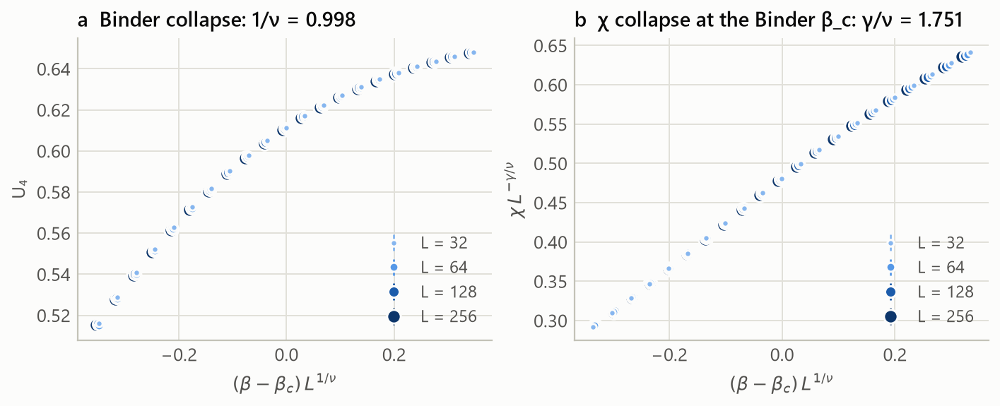

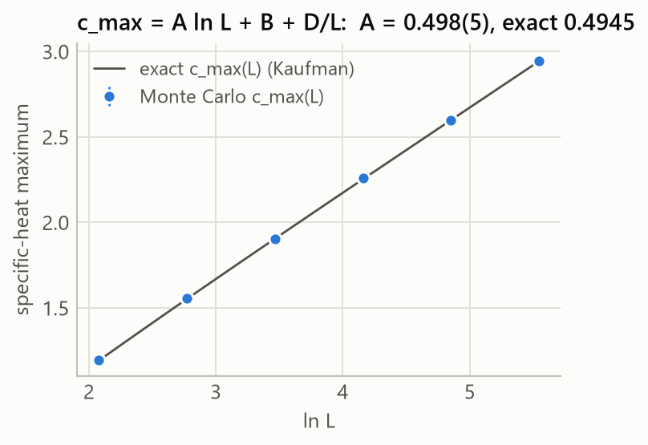

## 7. Critical slowing down and dynamic exponents (E04)

**Question.** How does the cost of an independent sample grow with system
size at $T_c$ for local and cluster algorithms?

**Setup.** At the exact $\beta_c$, $2\times10^5$ measurements per run. For
Metropolis and heat bath, measurements are spaced by up to 32 sweeps at the
largest sizes to keep $N_\text{meas}/\tau\approx10^3$. Integrated
autocorrelation times come from the Γ-method and are converted to sweeps
(for Wolff: flipped spins / N). Fits $\tau = aL^z$ use $L\ge16$.

| τ_int(m²) in sweeps | L = 8 | 16 | 32 | 64 | 128 | 256 |
|---|---|---|---|---|---|---|
| Metropolis | 2.94(7) | 8.5(3) | 36.9(19) | 173(9) | 682(37) | — |
| Heat bath | 6.4(2) | 24.0(14) | 120(10) | 552(49) | 2126(187) | — |
| Swendsen–Wang | 2.56(5) | 3.06(7) | 3.66(9) | 4.31(12) | 4.96(14) | 5.52(17) |
| Wolff | 1.02(2) | 1.30(2) | 1.48(3) | 1.71(3) | 1.82(3) | 2.04(4) |

| algorithm | z_int (energy) | z_int (m²) | literature |
|---|---|---|---|
| Metropolis | 1.80(2) | 2.12(3) | 2.1667(5) (Nightingale & Blöte 1996) |
| Heat bath | 1.90(3) | 2.18(5) | 2.17 (same dynamic class, model A) |
| Swendsen–Wang | 0.29(1) | 0.22(1) | ≈ 0.25 (Coddington & Baillie 1992) |
| Wolff | 0.28(1) | 0.16(1) | ≈ 0.25 (Coddington & Baillie 1992) |

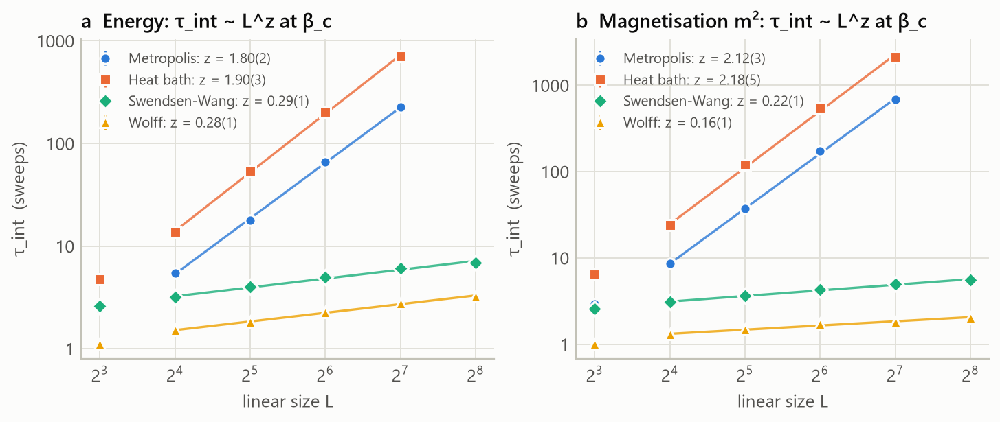

For the local algorithms the magnetisation, which couples to the slowest
mode, gives $z = 2.12(3)$ and $2.18(5)$, consistent with the accepted 2.17.
The energy relaxes faster and shows a smaller *effective* exponent at these
sizes, a well-known correction effect. Heat bath is about three times slower
than sequential Metropolis at equal sweep count. Both cluster algorithms
remove critical slowing down almost completely, with $z\approx0.2$–$0.3$ in
sweep units. At $L = 128$ one Wolff sweep equivalent decorrelates the
magnetisation about 375 times faster than a Metropolis sweep, and the ratio
grows as $L^{1.96}$. This is why all finite-size-scaling studies in this report
use cluster updates.


## 8. Convergence of Wang–Landau sampling (E05)

**Question.** Flat-histogram methods estimate $g(E)$ with a stochastic
modification factor. How does their error behave with simulation time, and
does the $1/t$ refinement fix the known saturation of the original algorithm?

**Setup.** 16×16 Ising model, full energy range (255 levels), eight
independent runs of each variant up to $10^{10}$ trial moves. The error
$\overline{|\ln\hat g - \ln g_\text{exact}|}$ is measured against the exact
density of states of E02 at 36 logarithmically spaced times.

**Result.**

| algorithm | mean \|Δ ln g\| at t = 10¹⁰ | late slope of the error | max \|Δc\|, T = 1.5–3.5 |
|---|---|---|---|
| Wang–Landau (flatness 80 %) | 3.4 × 10⁻² | −0.03 | 4.3 × 10⁻³ |
| 1/t refinement | 3.6 × 10⁻³ | −0.55 | 7.3 × 10⁻⁴ |

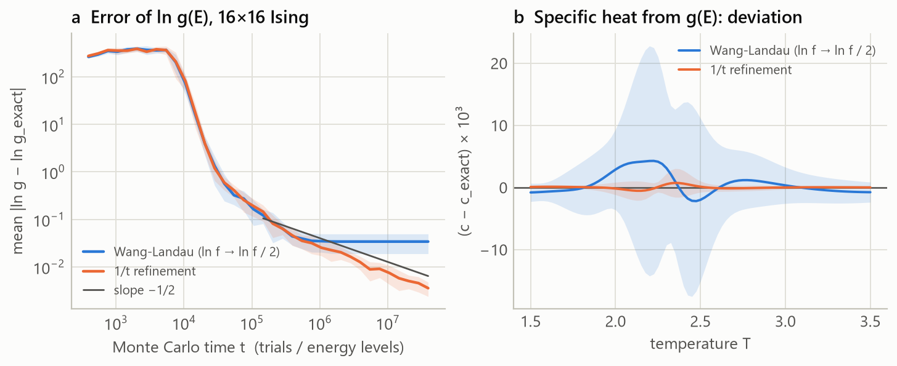

Both variants behave identically until $t\approx10^6$ (in units of trials per
level). Then the original algorithm freezes: halving $\ln f$ after every flat
histogram makes the modification factor vanish faster than the statistical
noise averages out, and the error stops decreasing (slope −0.03). With
$\ln f = N_\text{levels}/t$ the error keeps decaying with slope $-0.55$,
consistent with the predicted $t^{-1/2}$, and ends ten times smaller. This
matters downstream: the run-to-run spread of the specific heat near $T_c$
(panel b) shrinks from $\pm2\times10^{-2}$ to $\pm2\times10^{-3}$. This
reproduces the central result of Belardinelli & Pereyra (2007) against an
exact reference.

## 9. A strongly first-order transition: the 10-state Potts model (E06)

**Why it is hard.** At a first-order transition the ordered and disordered
phases coexist, and configurations interpolating between them contain two
interfaces of length $L$. They are suppressed by $e^{-2\sigma_{od}L}$. A
canonical simulation must pass through these configurations to move between
the phases, so its tunnelling time grows exponentially with $L$ and
reweighting cannot see the suppressed region at all.

**Setup.** Wang–Landau with the $1/t$ refinement on the energy window
$e\in[-1.95, -0.60]$ provides $\hat g(E)$ for $L = 8\ldots48$. A multicanonical
run with weights $1/\hat g$ then samples the window uniformly
($3\times10^5$–$6\times10^5$ sweeps, 1440–5266 tunnelling round trips between
the phases per size). Canonical distributions follow by reweighting; errors
come from a jackknife over 20 blocks of each time series, re-running the
whole analysis per block.

**Estimators.**

* the equal-weight point $\beta_\text{eqw}(L)$, where both phases carry
  probability ½, which approaches $\beta_c$ as $L^{-2}$;
* the latent heat from the specific-heat maximum,
  $c_\text{max}/N = (\beta\Delta e/2)^2 + B/N$ (Challa, Landau & Binder 1986),
  and, for comparison, from phase-conditional mean energies at equal weight;
* the interface tension from the depth of the valley between the peaks,
  $2\sigma_{od}(L) = L^{-1}\ln(P_\text{max}/P_\text{min})$.

**Results.**

| quantity | estimator | Monte Carlo | exact | deviation |
|---|---|---|---|---|
| latent heat Δe | c_max route, L ≥ 16 | 0.6937(51) | 0.696049 | −0.5σ |
| latent heat Δe | conditional means, plateau L ≥ 24 | 0.6891(41) | 0.696049 | −1.7σ |
| β_c | equal weight, β_c + b/L² | 1.42561(33) | 1.4260624 | −1.4σ |
| β_c | equal height, + b/L² + c/L⁴ | 1.42520(59) | 1.4260624 | −1.5σ |
| 2σ_od | valley depth, + b/L | 0.092(9) | 0.0947 ᵃ | −0.3σ |

ᵃ $2\sigma_{od}$ equals the inverse disordered-phase correlation length at the
transition, which is known exactly (Borgs & Janke 1992).


The distributions at equal height (panel a) develop the textbook double peak.
The valley deepens with $L$, and the peaks approach Baxter's coexisting
energies $e_o = -1.6643$ and $e_d = -0.9682$. The two latent-heat estimators
approach the exact value from opposite sides (panel b). The specific-heat
route converges from above with an $O(1/N)$ correction, while the
phase-conditional means stay 1–2 % low up to $L = 48$. That residual is
a genuine systematic effect: with $\ln(P_\text{max}/P_\text{min})\approx4.7$,
mixed-phase configurations still contribute about 1 % of the weight and pull
both conditional means towards the middle. The exponentially small
corrections expected for $L\gg\xi_d\approx10.6$ only set in at larger sizes.
This is the kind of systematic error a first-order analysis must identify
rather than average away.


## 10. The Berezinskii–Kosterlitz–Thouless transition of the XY model (E07)

**Why it is hard.** The 2D XY model has no long-range order at any $T>0$. Its
transition is driven by the unbinding of vortex–antivortex pairs, and the
correlation length diverges exponentially, $\xi\sim e^{b/\sqrt{T-T_\text{BKT}}}$.
There is no power law to fit, and finite-size corrections are
*logarithmic*: at accessible sizes they are large and decay painfully slowly.
The universal observable is the jump of the helicity modulus from
$2T_\text{BKT}/\pi$ to zero.

**Setup.** $L = 8\ldots128$ at 19 temperatures from 0.70 to 1.20 (spacing
0.01 around the transition), updates Metropolis + 2 over-relaxation sweeps +
Wolff clusters, $2\times10^4$–$4\times10^4$ measurements per run,
Γ-method errors on $\Upsilon = N^{-1}(\langle C\rangle - \beta\langle S^2\rangle)$.

**Results.**

| estimator | T_BKT | χ² / dof |
|---|---|---|
| crossings, $T^* = T_\text{BKT} + a/(\ln L)^2$ | 0.8983(5) | 17.2 / 2 — rejected |
| crossings, $T^* = T_\text{BKT} + a/(\ln L + c)^2$ | 0.8879(36) | 0.3 / 1 |
| Weber–Minnhagen, fine grid + bootstrap | 0.8917(5) | ≈ 1.5 at the minimum |
| literature (Hasenbusch 2005) | 0.89294(8) | |

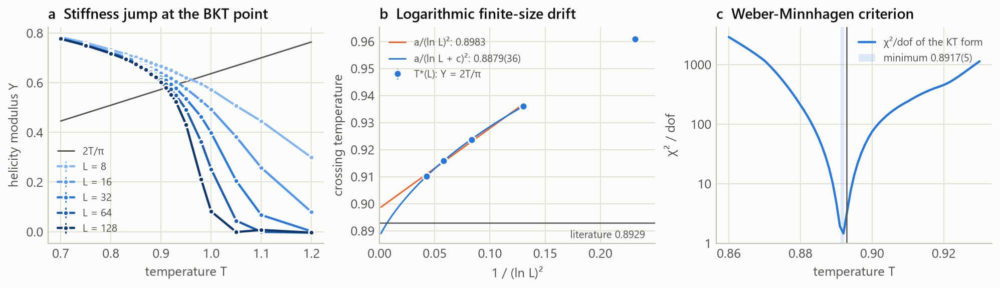

The helicity modulus develops the expected jump, steepening with $L$ (panel
a). The crossings with $2T/\pi$ drift from 0.961 ($L = 8$) to 0.910
($L = 128$), which shows how slow the logarithmic approach is. The textbook
extrapolation in $1/(\ln L)^2$ is rejected by its own χ². Once the RG scale
$L_0$ is allowed ($\ln L\to\ln L/L_0$) the fit is good and the estimate agrees
with the high-precision value within 1.4σ, at the price of an eight times
larger error. The Weber–Minnhagen criterion uses the full $L$ dependence at fixed
$T$ and is far more precise. It lands 0.14 % (2.4σ) below the reference, a
residual consistent with the next-order logarithmic corrections the
one-parameter KT form leaves out at $L\le128$. The effective exponent from
$\chi\sim L^{2-\eta}$ at $T = 0.89$ is $\eta_\text{eff} = 0.2311(8)$, below
the asymptotic 1/4 as expected from the multiplicative logarithmic
correction $(\ln L)^{-1/8}$. This is the model where uncritical fitting would
be most misleading, and the χ² test is what exposes it.


## 11. The 3D Ising model: no exact solution (E08)

**Question.** Applied to a model without an exact solution, does the
pipeline reproduce the best available numbers (conformal bootstrap and
large-scale Monte Carlo)?

**Setup.** $L = 8, 12, 16, 24, 32, 48$ (up to 110 592 spins); for each size
three Wolff runs around $\beta_0 = 0.2216546$ with $4\times10^5$ (L ≤ 16)
down to $10^5$ (L = 48) measurements, combined by MBAR. The critical
coupling is determined from the data. The exponents are then evaluated at
*our* β_c, so no literature value enters the analysis except the
correction-to-scaling exponent $\omega = 0.83$ used in the corrected fits.

**Critical point.** Binder crossings $(L, 2L)$ converge monotonically:

| pair | (8, 16) | (12, 24) | (16, 32) | (24, 48) |
|---|---|---|---|---|
| β* | 0.221868(14) | 0.2217288(85) | 0.2216802(63) | 0.2216685(38) |

Extrapolating with $\beta^* = \beta_c + aL^{-1/\nu-\omega}$ gives
**β_c = 0.2216505(39)**, 1.1σ from the reference 0.221654626(5)
(Ferrenberg, Xu & Landau 2018), a relative precision of $2\times10^{-5}$.
The crossing values of the cumulant extrapolate to $U^* = 0.4630(11)$ against
0.4655 (−2.2σ).

**Exponents at the estimated β_c.**

| quantity | observable | plain fit, L ≥ 12 | with $L^{-\omega}$, all L | literature |
|---|---|---|---|---|
| 1/ν | dU/dβ | 1.6038(40) | 1.591(13) | 1.58737 |
| 1/ν | d ln⟨m²⟩/dβ | 1.6164(18) | 1.5740(54) | 1.58737 |
| γ/ν | χ | 1.9784(17) | 1.9569(53) | 1.96370 |
| β/ν | ⟨\|m\|⟩ | 0.5135(10) | 0.5222(34) | 0.51815 |

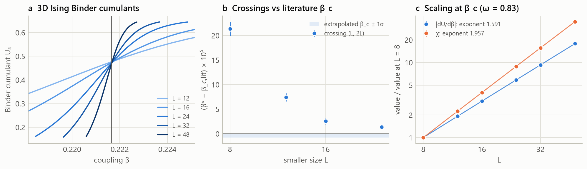

The plain power-law fits are biased by 4–16σ. Unlike in 2D, the leading
correction in 3D decays only as $L^{-0.83}$, and at $L\le48$ it is far from
negligible. With the correction term the four estimates move to within
0.3σ, 2.5σ, 1.3σ and 1.2σ of the conformal-bootstrap values, with χ²/dof
between 0.4 and 0.9. The residual 2.5σ in the logarithmic-derivative
estimate and the slightly low $U^*$ are consistent with higher-order
corrections that a single $L^{-\omega}$ term cannot absorb at these sizes.


## 12. The 3D Edwards–Anderson spin glass (E09)

**Why it is hard.** Quenched random couplings make the free-energy
landscape rugged, and single-spin dynamics freeze long before the
transition. Every observable must also be averaged over disorder
realisations, whose sample-to-sample fluctuations dominate the error budget.
The spin-glass transition of the 3D model with Gaussian couplings was only
established convincingly with dimensionless correlation-length crossings
(Ballesteros *et al.* 2000; Katzgraber, Körner & Young 2006).

**Setup.** Parallel tempering with two independent replica sets per
temperature (16–24 temperatures between 0.6 and 2.0, geometric spacing,
swap acceptance ≥ 42 % everywhere). Sizes and samples: $L = 4$ (600
samples), 6 (400), 8 (200), 10 (100). Runs last $2^{13}$–$2^{17}$ PT sweeps,
with measurements accumulated in logarithmic time bins and the last bin used
for equilibrium averages. Errors come from a bootstrap over disorder
samples. The campaign took about 42 minutes on 7 cores.

**Equilibration.** For Gaussian disorder the identity
$[e] = -\tfrac z2(1-[q_l])/T$ holds exactly in equilibrium, with the two sides
approaching from opposite directions (panel d). For $L = 10$ at the lowest
temperature $T = 0.60$ the residual is $2.2\sigma$ in the fourth-to-last bin
and below $1\sigma$ in the last three. In the final bin it is below
$1.1\sigma$ at every temperature. The runs are equilibrated.

**Results.** Pairwise crossings of $\xi_L/L$ between successive sizes are
ill-conditioned at these sample sizes: the curves cross at a shallow angle,
and the bootstrap spread of the crossing is ±0.1 (e.g. $(4,6)$: 1.04(11),
$(8,10)$: 1.21(11)), while the curves of $L = 6$ and 8 cannot be separated at
all. A joint finite-size-scaling fit of all sizes,
$\xi_L/L = F\big((T-T_c)L^{1/\nu}\big)$ with quadratic $F$ on
$T\in[0.80, 1.30]$, uses the data far better:

| quantity | Monte Carlo | literature (Katzgraber, Körner & Young 2006) |
|---|---|---|
| T_c | 0.938(54) | 0.951(9) |
| ν | 2.19(20) | 2.44(9) |
| χ² / dof of the scaling fit | 23.1 / 24 | |

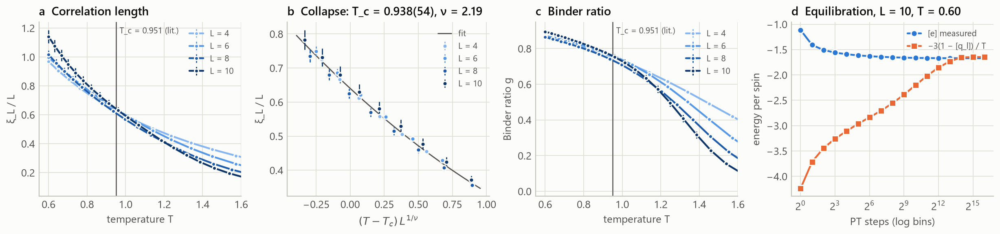

Both values agree with the literature within 1.2σ. The data collapse (panel
b) is consistent with the error bars. The Binder ratio (panel c) shows the
behaviour known for the 3D Gaussian model: curves for different $L$ merge
below $T\approx1.1$ instead of crossing clearly, which is why $\xi_L/L$ is the
observable of choice. The statistical error on $T_c$ is about six times the
literature's, as expected from far fewer disorder samples (100–600 per size)
and smaller sizes. This is a faithful small-scale reproduction of a
state-of-the-art analysis, not a competitive measurement.


## 13. Performance (E10)

Single-core throughput on an Intel i7-13700K (site updates per second,
L = 64, measured after compilation):

| system | update | 10⁶ site updates / s |
|---|---|---|
| 2D Ising | heat bath | 163 |
| 2D Ising | Metropolis (sequential) | 117 |
| 2D Ising | Metropolis (random site) | 75 |
| 2D Ising | Swendsen–Wang | 31 |
| 2D Ising | Wolff | 31 |
| 3D Ising | Wolff | 16 |
| 2D Potts, q = 3 | Metropolis / Wolff | 96 / 32 |
| 2D XY | over-relaxation / Metropolis / Wolff | 46 / 22 / 20 |
| 3D Heisenberg | heat bath / Wolff | 14 / 8 |

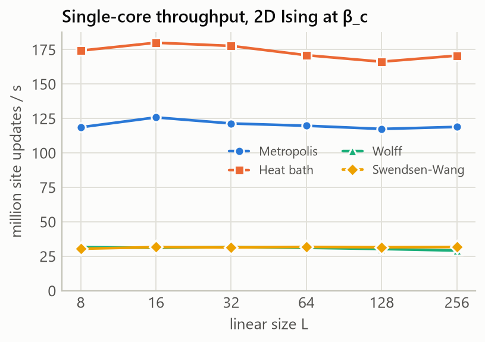

Throughput is independent of lattice size from $L = 8$ to 256. Heat bath beats
Metropolis for the Ising model because both are table-driven and heat bath
needs no accept/reject branch. The cluster algorithms are about four times
slower per site update, which is negligible against their factor-375 gain in
decorrelation at $L = 128$ (§7). Random-site Metropolis pays for its extra
random number: `Generator.integers` is about five times slower inside numba
than a scaled uniform double, so the kernels draw site indices from a single
double (bias below $n/2^{53}$).

## 14. Discussion

**What the exact references establish.** The 2D Ising model tests every layer
of the pipeline against exact answers:

* the samplers: 160 pulls consistent with $\mathcal N(0,1)$ (E01);
* the error analysis: Γ-method errors of non-linear estimators have the right
  size (E01), jackknife errors of reweighted curves reproduce the exact
  finite-size specific heat at six sizes, with one 2.8σ deviation (E03);
* the reweighting: the MBAR free energies agree with $\ln Z$ from Kaufman's
  formula (unit tests);
* the finite-size-scaling machinery: all exponents recovered to within 1.3σ
  at $10^{-4}$–$10^{-3}$ precision (E03).

Without that calibration the results for the XY model, the 3D Ising model and
the spin glass would carry much less weight.

**Systematic errors are the real limitation.** At the precision reached
here, statistical errors are often smaller than the effect of neglected
corrections to scaling. The report keeps the estimators that fail, because
they carry information:

| system | biased estimator | cause | remedy used |
|---|---|---|---|
| 2D Ising | χ′-peak height and position | peak lies where corrections are large | fixed-β_c estimators |
| 2D Ising | plain d ln⟨m²⟩/dβ fit | analytic background term | background in the fit |
| 2D Ising | c_max ~ A ln L | ln L / L corrections | Ferdinand–Fisher form |
| XY | T* = T_BKT + a/(ln L)² | missing RG scale L₀ | ln(L/L₀) form, Weber–Minnhagen |
| q = 10 Potts | phase-conditional means | mixed-phase contamination (~1 %) | specific-heat route |
| spin glass | pairwise crossings | shallow crossing angle, few samples | joint scaling fit |

In every case the χ² of the fit or a comparison of estimators exposed the
problem. Goodness-of-fit is not a formality in finite-size scaling.

**Lessons from the engineering.**

* *Adaptive tuning must be bounded.* Early in the campaign the Wolff
  auto-tuner, which sets the number of clusters per measurement to
  $N/\langle|C|\rangle$, measured tiny clusters in the hot initial state. It
  then scheduled thousands of clusters per measurement, each huge once the
  system ordered. At $L = 256$ a five-minute run took over an hour. The fix
  caps the change to a factor 4 per tuning chunk; a regression test now
  guards it, and every affected run was recomputed.
* *Optimiser output and jackknife bias correction do not mix.* Collapse
  parameters come from a numerical optimisation whose convergence noise the
  bias correction $n\hat\theta - (n-1)\bar\theta$ amplifies $n$-fold. For such
  estimators the full-sample value is reported with the jackknife error.
* *Reweighting needs guard rails.* Searching for crossings or maxima outside
  the β range where the reweighted ensemble keeps a reasonable effective
  sample size silently produces garbage at large $L$. All searches are
  clamped to such a window.
* *Keyed random streams pay off.* Re-running E06 after changing the analysis
  reproduced every per-size number exactly. Any discrepancy after a code
  change is therefore a real change, never noise.

**Possible extensions.** Larger lattices for the XY model and the spin glass
(the codes scale; only CPU time is missing); population annealing as an
alternative to parallel tempering; quantum Monte Carlo (stochastic series
expansion) validated against exact diagonalisation; GPU or multi-spin-coded
kernels for the Ising model.

## 15. Reproducibility

```bash
python -m pip install -e ".[dev]"
```
```bash
python -m pytest
```
```bash
python experiments/run_all.py
```

The test suite runs in about a minute. Run from scratch, the campaign takes
roughly three hours on a 24-thread desktop (i7-13700K, 6–8 worker processes);
E03, E04, E08 and E09 account for most of that time. Every number in this
report except the E10 timings is reproduced exactly from the root seed. Each
Markov chain, disorder sample and bootstrap draws from its own keyed random
stream, so the results do not depend on the number of workers or on the
order in which tasks finish. Raw time series are cached, so an interrupted
campaign resumes where it stopped.

## References

* R. J. Baxter, *J. Phys. C* **6**, L445 (1973).
* P. D. Beale, *Phys. Rev. Lett.* **76**, 78 (1996).
* R. E. Belardinelli, V. D. Pereyra, *Phys. Rev. E* **75**, 046701 (2007).
* B. A. Berg, T. Neuhaus, *Phys. Rev. Lett.* **68**, 9 (1992).
* H. G. Ballesteros *et al.*, *Phys. Rev. B* **62**, 14237 (2000).
* C. Borgs, W. Janke, *J. Phys. I France* **2**, 2011 (1992).
* M. S. S. Challa, D. P. Landau, K. Binder, *Phys. Rev. B* **34**, 1841 (1986).
* P. D. Coddington, C. F. Baillie, *Phys. Rev. Lett.* **68**, 962 (1992).
* A. E. Ferdinand, M. E. Fisher, *Phys. Rev.* **185**, 832 (1969).
* A. M. Ferrenberg, R. H. Swendsen, *Phys. Rev. Lett.* **61**, 2635 (1988); **63**, 1195 (1989).
* A. M. Ferrenberg, J. Xu, D. P. Landau, *Phys. Rev. E* **97**, 043301 (2018).
* M. Hasenbusch, *J. Phys. A* **38**, 5869 (2005).
* J. Houdayer, A. K. Hartmann, *Phys. Rev. B* **70**, 014418 (2004).
* H. G. Katzgraber, M. Körner, A. P. Young, *Phys. Rev. B* **73**, 224432 (2006).
* B. Kaufman, *Phys. Rev.* **76**, 1232 (1949).
* F. Kos, D. Poland, D. Simmons-Duffin, A. Vichi, *JHEP* **08**, 036 (2016).
* M. P. Nightingale, H. W. J. Blöte, *Phys. Rev. Lett.* **76**, 4548 (1996).
* L. Onsager, *Phys. Rev.* **65**, 117 (1944).
* M. R. Shirts, J. D. Chodera, *J. Chem. Phys.* **129**, 124105 (2008).
* F. Wang, D. P. Landau, *Phys. Rev. Lett.* **86**, 2050 (2001).
* H. Weber, P. Minnhagen, *Phys. Rev. B* **37**, 5986 (1988).
* U. Wolff, *Phys. Rev. Lett.* **62**, 361 (1989); *Comput. Phys. Commun.* **156**, 143 (2004).

Further method references are collected in [`theory.md`](theory.md).
